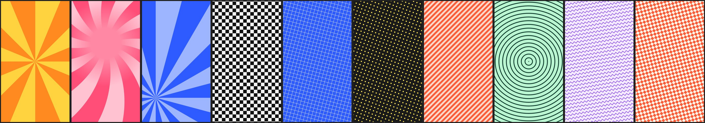
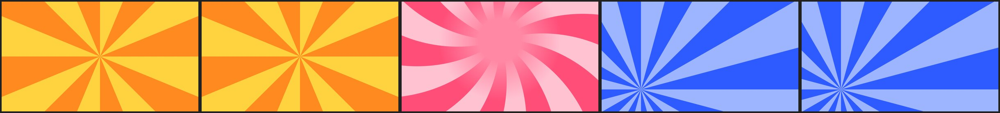

# 방사선·패턴·흔들림 (backdrops)

`templates/rays.mjs`·`patterns.mjs`·`noise.mjs`로 만든 9:16 8초 예제입니다(120BPM). 엔진 3.0.29 브라우저 Exporter로 렌더했고, `to-admaker-import.mjs`로 앱 불러오기 파일까지 만들어 `iterCount`가 그대로 넘어가는 것을 확인했습니다.


| 구간 | 내용 |
|---|---|
| 0–3초 | 노랑·주황 방사선 16줄이 박마다 720/16°씩 딱 돌고(`raysSpin` beat), "50%"가 꽂힌 뒤 살아 있는 듯 흔들림(`wiggleKeys` freq 2) |
| 3–5.5초 | 흰 도트 패턴이 20° 사선으로 두 박에 한 칸씩 흐르고(`patternDrift` xy), 흰 카드 묶음이 같은 seed로 둥둥 뜸(freq 0.5) |
| 5.5–8초 | 소용돌이 방사선(twist 45, 가운데 흐림 0.45)이 천천히 반시계로, 아래 노랑·검정 줄무늬 띠가 박마다 한 주기 흐름 |


## 수용 기준 검사

```bash
node --test tests/*.test.mjs          # 부채꼴 수·색 교대·짝수, 이동 벡터·상자, wiggle 결정성·상관·부드러움·평균 (12개)
node check-render.mjs build            # → check_9x16.json, check_16x9.json (구간마다 한 주기 = 1초)
node <스킬>/templates/render/render.mjs check_9x16.json out/c916 --stills 0.5:19.5:0.5   # 16:9도 같게
node check-render.mjs verify out/c916 out/c169
```

`verify`는 방사선 3종이 9:16·16:9 모두 어느 각도에서도 네 모서리가 비지 않는지, 방사선 비트 회전과 패턴 7종(6종 + 체커 30° 대각)이 한 주기 뒤 같은 프레임인지(PSNR inf), 반 주기 뒤에는 실제로 움직였는지 봅니다. 렌더 결과 시트:




```bash
node build.mjs            # → project.json
node <스킬>/templates/render/render.mjs project.json out/backdrops_9x16.mp4
node <스킬>/templates/to-admaker-import.mjs project.json admaker-import.json
```

실제 광고에서는 소재 장면 사이의 모션 전용 씬, 엔드카드, 누끼 제품 뒤 배경에 씁니다. 소재(영상·사진) 위에 패턴·방사선을 덮지 않습니다.
