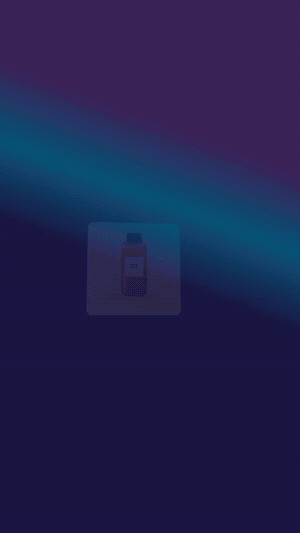
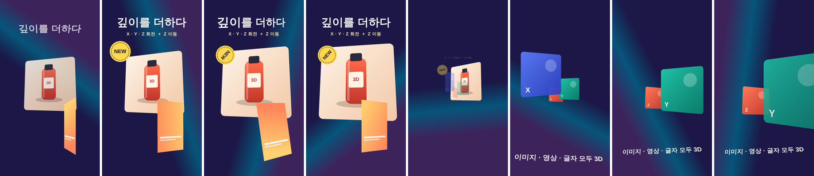

# 이미지·영상·글자 Z축 + X·Y·Z 회전 샘플

1080×1920, 8초, 30fps. 제품 사진(이미지), 휴대폰 화면(영상), 배지, 카드 3장, 글자 3개가 모두 **깊이(z)와 X·Y·Z 회전**으로 움직입니다. 배경 영상만 평면입니다. 렌더에는 `@admaker/engine` main(3.0.9 다음, `transform3d` 포함)을 썼습니다.





| 시간 | 클립 | 고정 자세 `transform3d` | 움직임 (keyframes) |
|---|---|---|---|
| 0–4.6초 | 제품 사진 (Image) | rotateY −18, rotateX 8, perspective 1200 | `3D 이동` 등장 → z 0→260 돌리 인 + rotateY → `3D 이동` 퇴장 |
| 0.4–4.6초 | 휴대폰 화면 (Video) | rotateY 24, z −250 | rotateY −90→0 뒤집기 등장, Z 회전(angle) −8°, 뒤로 넘기며 퇴장 |
| 0.9–4.6초 | NEW 배지 (Image) | 없음 (transform.angle −12) | z −1500에서 다가오며 angle −180→0, 한 바퀴(360°) 돈 뒤 멀어짐 |
| 4.4–8초 | 카드 X·Y·Z (Image) | z 0 / −900 / −1800, 기울기 조금씩 | 모두 같은 양만큼 앞으로(z +1300): 카메라가 들어가는 느낌, 맨 앞 카드는 지나가며 사라짐 |
| 0–4.6초 | 제목 (Text) | perspective 900 | rotateX −85→0 접혀 펴짐, rotateY 흔들림, rotateX 85로 퇴장 |
| 0.6–4.6초 | 부제 (Text) | 없음 | `3D 이동`(rotateX 60) 등장·퇴장 |
| 5–8초 | 마지막 문구 (Text) | rotateX 18 | z −1800에서 rotateY −50→0으로 다가옴, angle −4° |

## 값이 들어가는 곳

- **고정 자세** = 클립 `transform3d { rotateX, rotateY, z, perspective }`. Studio 속성 패널 "회전 · 3D"의 X 회전·Y 회전·Z 위치·원근과 같은 값이고 프로젝트에 그대로 저장됩니다. 0인 값은 적지 않아도 됩니다.
- **Z 회전** = `transform.angle` (패널의 Z 회전).
- **움직임** = keyframes의 `x`, `y`, `z`, `rotateX`, `rotateY`, `angle`, `opacity`. 고정 자세 위에 더해집니다. 정지점마다 같은 키를 다 적고, 구간 이징은 앞 정지점의 `easing`입니다(`build.mjs`의 `at()`).
- **3D 이동** = `options.motionPreset: "move3d"`(등장) / `"move3dOut"`(퇴장)인 1초 keyframes. 애니메이션 패널 "3D 이동"이 만드는 것과 같은 모양이라 앱에서 상세 설정(X·Y·Z 이동, X·Y·Z 회전, 원근, 페이드)으로 다시 고칠 수 있습니다.
- z는 화면 가운데(소실점)를 기준으로 커지고 작아집니다. z +값은 다가옴, −값은 멀어짐이고 상한은 원근의 90%입니다(원근 1000 → z 900).
- **레이어 순서는 z가 아니라 트랙 순서**입니다. 카드 3장은 먼 것부터 넣어 가까운 카드가 위 트랙에 오게 했습니다.

## 다시 만들기

프로젝트 폴더에 이 폴더의 파일과 스킬의 `templates/render/`를 두고, `@admaker/engine`(main), vite, playwright를 설치합니다.

```sh
sh make-footage.sh            # render/bg.mp4, render/screen.mp4 (자리표시 영상)
node build.mjs                # → project.json (영상 src는 /bg.mp4, /screen.mp4)
node render/render.mjs project.json out/clip_3d_depth.mp4
node render/render.mjs project.json out/stills --stills 0.5:7.5:1
```

## admaker 앱에서

앱에서 3D가 보이려면 엔진 다음 태그와 앱 엔진 올리기가 필요합니다(MCP는 `yarn release` 후).

- 직접: 클립 선택 → 속성 패널 "회전 · 3D"에서 위 표의 고정 자세를 넣고, 애니메이션 패널에서 "3D 이동"을 고릅니다.
- MCP: `update_clip { clipId, patch: { rotateX, rotateY, z, perspective, animations: [build.mjs의 keyframes] } }`. Z 회전은 `angle`. 고정 자세를 지울 때는 빼지 말고 0을 보냅니다.
- 이 project.json을 앱으로 가져올 때는 `to-admaker-import.mjs`가 `transform3d`를 그대로 넘깁니다.
