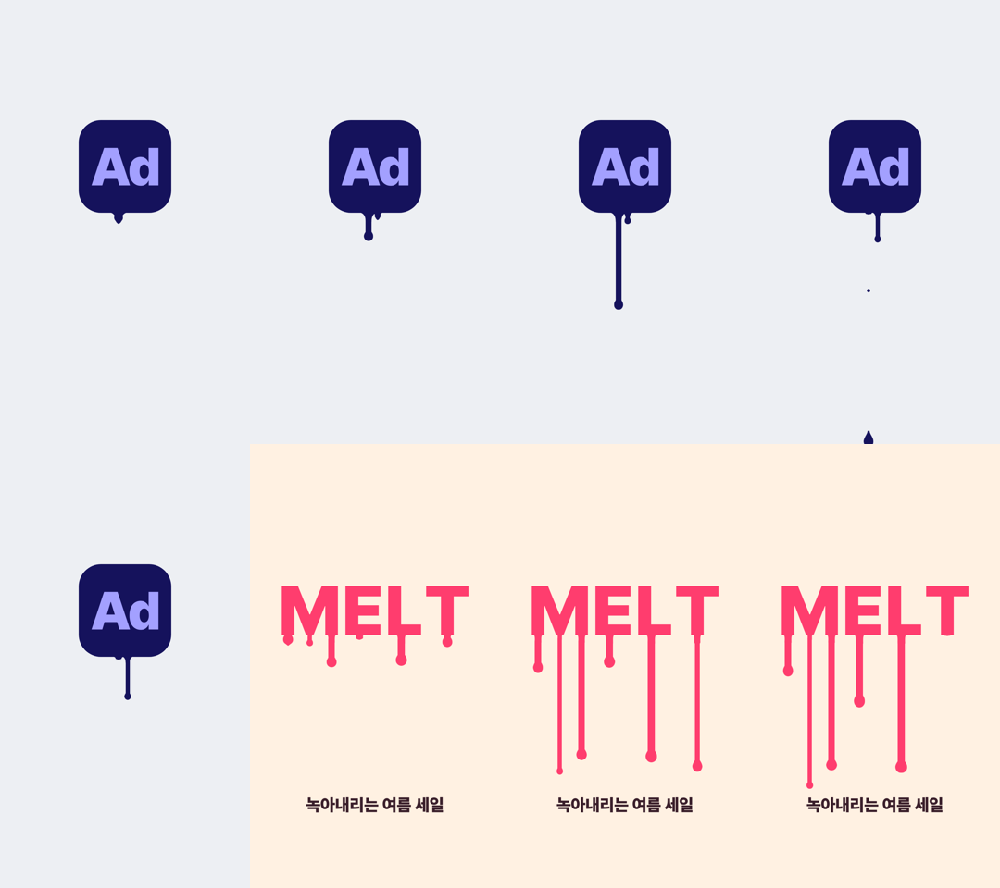

# 흘러내림 (drip-melt)

1080×1920, 7.4초. 샷 카드: `plugin/skills/admaker/references/shots/drip-melt.md`.

| 구간 | 대상 | 설명 |
|---|---|---|
| 0–3.4초 | 둥근 아이콘(400px, 모서리 96) | `boxDripClips` 2개: 하나는 늘어나다 끊겨 떨어지고(위성 방울 포함), 하나는 짧게 매달려 출렁임 |
| 3.4–7.4초 | Pretendard Black 300px "MELT" | `textDripClips`: 글자 패스에서 기준선까지 내려오는 획 자리 6곳에 드립, 가장 긴 하나가 끊겨 떨어짐 |

- `node build.mjs --font Pretendard-Black.otf` → `project.json` (opentype.js 필요, woff2는 못 읽음)
- 렌더: `@admaker/engine` 3.0.28 렌더 하니스. 같은 시각 스틸을 두 번 찍어 PNG가 같음(결정적).
- 같은 색 Shape(path·rounded·circle)와 gsapTimeline만 써서 `to-admaker-import.mjs`로 앱까지 그대로 갑니다.
- 끊기는 순간: 줄기가 0.3초 동안 가늘어짐 → 남은 목의 뾰족한 끝이 튕겨 올라가 출렁 → 떨어지는 줄기는 방울로 빨려 들어감 → 위성 방울. 칼로 자른 단면이 생기지 않게 목 아래끝은 원뿔, 줄기 윗끝은 둥근 알약입니다.
