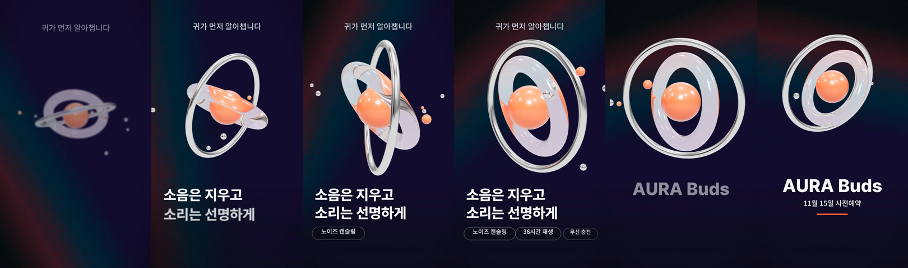

# GSAP + three.js 샘플: 무선 이어폰 런칭 티저

1080×1920, 6초, 30fps. `@admaker/engine` 3.0.7 브라우저 Exporter로 렌더했습니다. 브랜드 "AURA Buds"와 스펙 문구는 샘플용 가상 값입니다.




| 시간 | 일어나는 일 | 쓰는 것 |
|---|---|---|
| 전체 | 바닥 소재(사용자 영상), 원본 그대로 | Video z 2 |
| 0.2–1.1초 | 3D 링 오브젝트가 아래에서 떠오름 | Adapter `three` 커스텀 씬 `orbit-hero` + 클립 `gsapTimeline`(from y·opacity·scale·blur) |
| 0–2.6초 | 씬 안: 카메라가 다가가며 내려오고 링이 `back.out`으로 섬 | 씬 안의 멈춘 GSAP 타임라인 `tl.time(time)` (`"<0.5"`, `"<0.2"` 겹침) |
| 0.3초 | 훅 | `gsapTimeline` 올라오기 |
| 1.0초 | 헤드라인 두 줄, 둘째 줄 4프레임 늦게, 자리잡으며 펀치 | `gsapTimeline` 3단 (입장 → `"-=0.06"` 펀치 → 복귀) |
| 2.4 / 2.9 / 3.4초 | 비트마다 스펙 칩이 하나씩 팝, 먼저 나온 칩은 다음 비트에 작게 펀치. 3D 코어도 같은 비트에 맥동 | `gsapTimeline` `back.out(2)` + 숫자 position, 씬 `params.beats` |
| 3.8–4.1초 | 카피 퇴장(입장 절반 길이, `power2.in`), 3D가 위로 올라가며 작아짐 | `gsapTimeline` 숫자 position |
| 4.2–6초 | 워드마크 + CTA + 강조 밑줄, 1.3초 이상 정지 | `gsapTimeline`, `wipe` |

## 다시 만들기

프로젝트 폴더에 `templates/`의 `motion.mjs`, `fonts.mjs`, `validate.mjs`, `to-admaker-import.mjs`, `render/`와 `references/fonts.json`을 복사하고, 이 폴더의 `scenes/`를 둡니다.

```sh
node sample-gsap-three.mjs project.json                 # 렌더 하니스용은 --local-fonts (render/fonts/, render/footage.mp4)
node validate.mjs project.json
node render/render.mjs project.json out/gsap_three_9x16.mp4
node render/render.mjs project.json out/stills --stills 0:6:0.5
node to-admaker-import.mjs project.json admaker-import.json
```

- 폰트: Pretendard ExtraBold(제목), Noto Sans KR 500(본문).
- 바닥 소재는 실제 사용자 영상 자리입니다. 샘플은 직접 만든 자리표시 영상(어두운 그라데이션)으로 렌더했고, `project.json`에서는 `assets/input.mp4`를 가리킵니다.
- 결정성: 같은 시간의 스틸을 따로 두 번 뽑아 PNG가 바이트 단위로 같은지 확인했습니다(2.5, 3.0, 3.5초).
- 글자 받침은 아래 34%, 최대 불투명도 0.55. 3D는 배경 투명이라 소재를 덮지 않습니다.

## 앱으로 넘길 때

`to-admaker-import.mjs`는 3D 클립(`orbit-hero`)을 뺍니다(커스텀 씬은 앱에 등록되어 있지 않음). 나머지 글자·칩·CTA의 `gsapTimeline`은 그대로 넘어갑니다. 앱에서도 3D가 보여야 하면 3D 클립만 따로 렌더해 Video/Image 클립으로 바꿔 넣습니다(`references/three.md` §6).

## 이 샘플에서 볼 것

- `sample-gsap-three.mjs`의 `gt([...])`: 클립 모션으로 쓰는 `gsapTimeline` 패턴(`references/gsap.md` §5). 늦은 입장은 `options.delay` 대신 첫 tween의 `position`에 대기를 넣습니다.
- `scenes/orbit-hero.js`: 시드 RNG 배치, 공유 렌더러를 `attach`에서 받는 환경광, 시간만 보는 `update`, 비트 펄스를 "마지막 비트로부터 지난 시간"으로 계산(이전 프레임 상태 없음).
