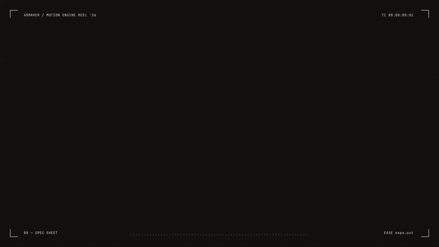
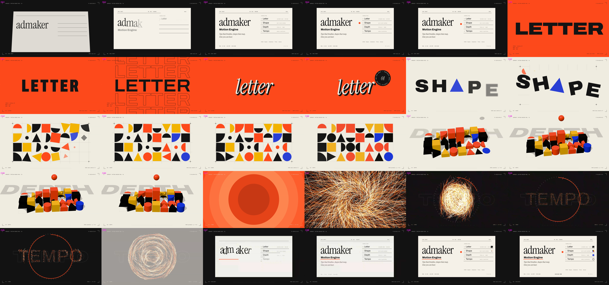

# 키네틱 타입 쇼릴: 글자 · 도형 · 깊이 · 템포

1920×1080, 15초, 30fps, 120 BPM. `@admaker/engine` 3.0.25(admaker-plugin 키네틱 타입 기능 PR) 렌더 하니스 `Exporter`로 렌더했습니다. 모든 장면이 엔진 클립(Text·Shape·Adapter)이고, 바닥 소재 없이 그래픽만으로 만든 쇼릴입니다.

| 장 (초) | 요소 | 쓰는 것 |
|---|---|---|
| 00 SPEC (0–2.5) | 스펙 시트 카드가 눕혀진 채 올라와 섬, 글자가 박에 맞춰 써지고 빨간 점이 튐, 빠질 때 가로 휩 | keyframes `rotateX`·`perspective`·`blur` (카드 모든 클립에 같은 입장), `stagger`, `wipe` 줄, `motionBlur` |
| 01 LETTER (2.5–5) | 굵은 글자가 박마다 폭이 62↔125로 숨쉬고, 윤곽선 메아리가 위아래로 쌓임, 이탤릭 세리프 돌출 글자로 바뀜, 회전 배지 | `fontVariation` + `paint` `wdth`·`wght`·`letterSpacing`, `stroke`만 있는 글자, `extrude`, `textPath` circle, `countUp`(축 값 표시) |
| 02 SHAPE (5–7.5) | "SH▲PE"가 부서지며 8×4 바우하우스 격자(정사각·원·반원·사분원·삼각)가 대각선 순서로 튀어나옴, 박마다 일부가 90° 뒤집히거나 색이 바뀜 | Shape `pie`(반원·사분원), `back.out(1.7)`/`back.inOut(1.7)`, `paint` `fillColor` |
| 03 DEPTH (7.5–10) | 같은 배치의 three.js 블록이 바로 위 시점(2D와 매치 컷)에서 비스듬히 눕고 솟아오름, 빨간 공이 박마다 튐, 공으로 다가가 화면이 덮임 | three 커스텀 씬 `depth-blocks`(`templates/scenes/`) |
| 04 TEMPO (10–12.75) | 동심원이 줄며 어둠을 드러내고, 입자가 소용돌이 → "TEMPO" → 도는 호로 모핑, 시계 눈금·진행 링·박마다 딸깍이는 초침 | script `particle-morph`(`templates/scripts/`), `textPath`(눈금), `pie` + `paint` `endAngle`(진행 링), `steps(n)` |
| 05 카드 (12.75–15) | 카드가 다시 섬, 워드마크 글자가 흩어진 자리에서 모여듦, 장마다 작은 아이콘, 깜빡이는 "AVAILABLE NOW" | `stagger` `scatter`, `wipe` 밑줄, keyframes `iterCount` |
| HUD (내내) | 모서리 괄호, 릴 제목, 실제 시간과 같이 가는 타임코드, 장 번호, 장마다 쓴 이징 이름, 눈금자 | `countUp` `format: "timecode"`, 장마다 글자색 바꿈 |

- 다시 만들기: `node build.mjs` → `project.json`. 필요한 것: `assets/fonts/`에 Archivo 가변 폰트(`Archivo[wdth,wght].ttf`), Instrument Serif Regular·Italic, JetBrains Mono(모두 OFL, google/fonts), `python3 synth.py` 후 `ffmpeg -i assets/mix_raw.wav -af loudnorm=I=-14:TP=-1 assets/mix.wav`, 템플릿의 `scripts/particle-morph.js`·`scenes/depth-blocks.js`를 프로젝트 `scripts/`·`scenes/`로. 렌더 하니스 `render/public/assets`가 `assets/`를 가리키게 둡니다.
- 사운드는 `synth.py`로 합성한 임시음(킥·클랩·하이햇·베이스, 장 경계 whoosh + hit, TEMPO 장 틱)입니다.
- 트랙 순서와 상관없이 겹침을 지키려고 모든 클립에 `zIndex = 1,000,000 + z`(명시 zIndex 구간)를 씁니다.
- 원본 레퍼런스의 구성(카드 → 타입 → 도형 → 3D → 시간 → 카드)을 따르되, 문구·배치·색 조합·장면 연결은 새로 만들었습니다.
