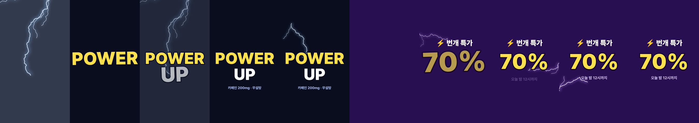

# 번개 (lightning)

`templates/lightning.mjs`로 만든 9:16 6초 예제입니다. 엔진 3.0.30 브라우저 Exporter로 렌더했고, `to-admaker-import.mjs`가 경고 없이 앱 불러오기 파일을 만듭니다. 샷 카드: `plugin/skills/admaker/references/shots/lightning-strike.md`.


| 구간 | 내용 |
|---|---|
| 0–3초 | 위에서 번개(가지 3개)가 "POWER UP" 뒤로 내리치며 세 번 깜빡이고, 같은 정지점으로 화면도 0.28만큼 번쩍. 1.7초에 작은 번개 한 번 더 |
| 3–6초 | 화면 왼쪽·오른쪽 가장자리에서 보라 전기가 번갈아 튐(`reshape`: 번쩍마다 다른 경로) + "번개 특가 70%" |



```bash
node --test tests/*.test.mjs     # 수용 기준: 결정성, 시작·끝점, 거리 상한, 점 개수, 가지, 깜빡임, 앱 가져오기·validate
node build.mjs                   # → project.json
node <스킬>/templates/render/render.mjs project.json out/lightning_9x16.mp4
node <스킬>/templates/to-admaker-import.mjs project.json admaker-import.json
```
