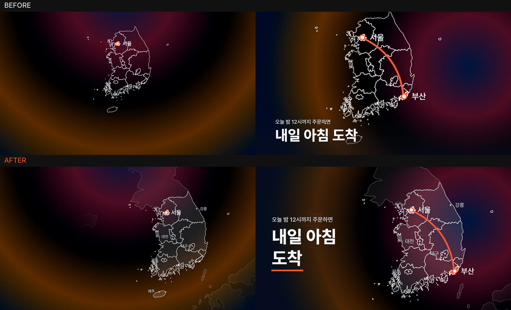

# 지도 샘플 샷: 서울 → 부산 배송

1080×1920, 6초, 30fps. `@admaker/engine` 3.0.5 브라우저 Exporter로 렌더했습니다.


| 시간 | 일어나는 일 | 쓰는 것 |
|---|---|---|
| 전체 | 바닥 소재(사용자 영상), 원본 그대로 | Video z 2 |
| 0–0.7초 | 선 지도(면 없음, 흰 경계선 + 그림자)와 강조 지역이 들어옴 | Image(SVG) + Shape path, `entrance` |
| 0.8–1.2초 | 서울이 칠해지고 핀·지명 | `paint`, 핀 팝(`holdFrom`), Text |
| 1.4–3.4초 | 경로가 그려지며 경로 쪽으로 1.55배 줌 | `strokeDraw`, `mapCamera` |
| 3.2–3.6초 | 부산이 강조색으로, 핀·지명 | `paint`, 핀 팝 |
| 3.5–4.8초 | 글자 띠 받침(아래 30%, 최대 0.6), 서브 카피, 헤드라인(그림자), 밑줄 | `entrance`(시차), `wipe` |

다시 만들기 (프로젝트 폴더에 `templates/`의 `map.mjs`, `motion.mjs`, `timeline.mjs`, `fonts.mjs`와 `references/fonts.json`을 복사한 상태):

```sh
npm i d3-geo
curl -L -o kor.geojson https://raw.githubusercontent.com/southkorea/southkorea-maps/master/kostat/2013/json/skorea_provinces_geo_simple.json
node sample-map.mjs project.json        # project.json
node validate.mjs project.json
node render/render.mjs project.json out/map_sample_9x16.mp4
node to-admaker-import.mjs project.json admaker-import.json
```

- 지도 데이터: southkorea/southkorea-maps의 시도 경계(통계청 KOSTAT 2013 기반). 광고에 쓸 때는 `CREDITS`에 적습니다. 데이터 파일은 이 저장소에 넣지 않았습니다.
- 폰트: Black Han Sans(제목), Noto Sans KR 500(본문). 렌더 하니스에서는 `--local-fonts`로 로컬 파일을 씁니다.
- 바닥 소재는 실제 사용자 영상 자리입니다. 샘플은 직접 만든 자리표시 영상(밤거리 보케)으로 렌더했고, `project.json`에서는 `assets/input.mp4`를 가리킵니다.
- 색·타이밍은 첫 렌더 뒤 고친 값입니다(줌 1.35 → 1.55, 지도 면 → 선만, 전체 어둡게 층 제거, 글자 받침 50% → 30%).

플래너 모드 템플릿: `template.json` (`node to-admaker-template.mjs project.json admaker-import.json template.json --group 배송지도 --name 경로-1`). 바닥 영상을 뺀 그래픽 오버레이만 들어 있고, admaker 앱 코드로 파싱과 씬 합성(6초 → 4초 씬)을 확인했습니다.

## 16:9 (1920×1080) 구성

같은 서울 → 부산 이야기를 가로 화면에 맞게 다시 짠 샘플입니다(`sample-map-16x9.mjs`, 엔진 3.0.28 렌더 확인).



세로 구성을 그대로 옮기면(위 BEFORE) 지도가 화면 높이 60% 남짓으로 작고, 흰 선만 떠 있어 어디 지도인지 잘 안 읽히고, 1.55배 줌에서 제주·남해안이 카피에 덮입니다. 16:9에서는 이렇게 바꿨습니다(AFTER).

| 바꾼 것 | 쓰는 것 |
|---|---|
| 지도는 오른쪽에 프레임 높이 88%, 카피는 왼쪽 세로 단 + 왼쪽 가장자리 받침 | `mapLayout(W, H)` |
| 남한보다 조금 넓게 투영해 휴전선 위(북한)와 바다가 보이게 | `makeProjection(features, box, { bounds: [[124.2, 33.0], [131.0, 39.4]] })` |
| 이웃 땅(북한·중국·일본·러시아) 흐린 윤곽, 남한 땅만 옅은 면(흰색 0.12), 카피 쪽으로 갈수록 사라짐 | `worldFeatures`, `baseMapSrc({ context, landFill, fade })` |
| 참고 도시 5곳(대전·대구·광주·강릉·제주) 작은 점 + 흐린 이름 | `placeMarks` |
| 카메라는 고정 1.55배 대신 경로와 참고 도시가 지도 상자에 남는 만큼(1.3배) | `fitCamera` |

```sh
npm i d3-geo world-atlas topojson-client
node sample-map-16x9.mjs project.json            # 16:9
node sample-map-16x9.mjs before.json --before    # 비교용: 고치기 전 방식
```

- 이웃 땅 데이터: Natural Earth 1:50m(world-atlas 패키지, ISC). 광고에 쓸 때 `CREDITS`에 적습니다.
