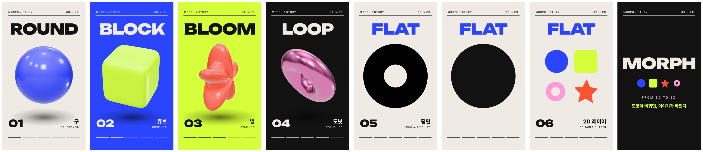

# 3D 모프 → 2D 샘플: 구 · 큐브 · 별 · 도넛 → 평면 링 → 2D 원 → 편집 가능한 2D 아이콘

1080×1920, 13.5초, 30fps, 120 BPM. `@admaker/engine` 3.0.10 브라우저 Exporter로 렌더했습니다. 바닥 소재 없이 모션그래픽만 있는 샘플입니다(배경은 단계마다 단색 Shape 와이프).




| 시간 | 장면 | 쓰는 것 | 앱 불러오기 |
|---|---|---|---|
| 0–2초 | 구 등장, 큰 단어 ROUND | three 커스텀 씬 `morph-shapes` (투명 배경) + Text `wipe`·`gsapTimeline` | 3D는 영상으로 구움 |
| 2–8초 | 구 → 둥근 큐브 → 퍼피 별 → 크롬 도넛 (박마다 변신, 배경 와이프) | 같은 씬. 모든 모양을 같은 (u, v) 격자로 만들어 위치·법선을 보간 | 3D는 영상으로 구움 |
| 8–9.4초 | 도넛이 정면으로 돌며 z가 0으로 눌려 2D 링 → 원판으로 닫힘 | 재질이 반사·조명 없는 단색(emissive)으로 바뀜 | 3D는 영상으로 구움 |
| 9.4–11.5초 | 엔진 2D 원이 같은 자리·크기로 이어 받아 터지고, 네 모양의 평면 아이콘이 2×2로 섬 → 두 번 자리 바꿈 | Shape circle·rectangle·star·stroke 링 + `gsapTimeline`(x·y·scale·angle) | 그대로(편집 가능) |
| 11.5–13.5초 | 엔드카드 MORPH 워드마크 + 미니 아이콘 | Text `characterAnimation` rise, Shape `gsapTimeline` | 그대로 |

## 3D → 2D 이어 받기

- 카메라 z=12, 세로 화각 30° → z=0 평면에서 1 단위 = 298.56px. 원판 반지름 1.4 → 엔진 원 반지름 418px, 화면 가운데(`shots/m-flat2d.mjs`의 `PX_PER_UNIT`).
- 원판이 닫힌 프레임(9.43초)에서 3D 원판과 엔진 원의 가장자리가 같은 픽셀(122–957px)인 것을 확인했습니다.
- 3D 배경이 투명(`background: null`)이라 큰 단어(z 15)는 3D 뒤, 번호·이름·진행 막대(z 40)는 앞에 그려집니다.

## 다시 만들기

프로젝트 폴더에 `templates/`를 복사하고 `timeline.mjs` 자리에 `timeline.sample.mjs`, 그리고 `brand.json`, `shots/`, `scenes/morph-shapes.js`, `bake.mjs`, `references/fonts.json`을 둡니다(`node templates/gallery.mjs use morph-3d-to-2d <폴더>`).

```sh
node build-project.mjs --look off --out project.json
node validate.mjs project.json
node render/render.mjs project.json out/morph_9x16.mp4
# 앱 불러오기: 3D 클립과 그 아래 레이어를 영상 하나로 굽고 Adapter 자리를 Video로 바꾼 project-app.json을 만든다
node bake.mjs && node render/render.mjs bake/morph3d.json baked/morph3d.mp4
node to-admaker-import.mjs project-app.json out/morph_9x16.admaker-import.json
```

- 폰트: Unbounded Black(큰 단어·번호), Space Grotesk Medium(라벨), Pretendard ExtraBold(한글). 렌더 환경에서 Pretendard CDN이 막히면 `shots/_m.mjs`처럼 `render/fonts/`의 로컬 파일을 씁니다.
- 바꿔 쓸 자리: `timeline.sample.mjs`의 `STAGES`(단계 색·단어·이름), `MORPHS`(변신 시각), `scenes/morph-shapes.js`의 `SHAPES`(모양 함수, 같은 격자면 무엇이든 됨).
- 효과음은 렌더 뒤 ffmpeg로 따로 섞었습니다(`gen-audio-kit.mjs` 임시음). 이 폴더에는 넣지 않았습니다.
