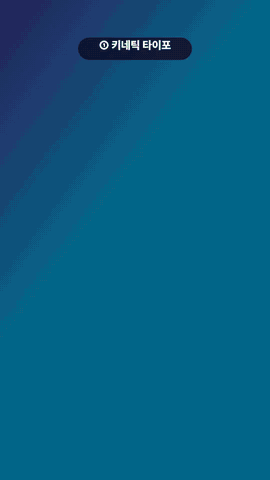
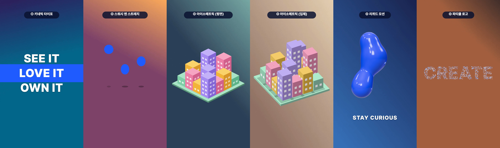

# 모션 스타일 샘플: 키네틱 타이포 · 스쿼시 앤 스트레치 · 아이소메트릭(평면/입체) · 리퀴드 · 파티클 로고

1080×1920, 21초(스타일마다 3.5초), 30fps. `@admaker/engine` 3.0.8 브라우저 Exporter로 렌더했습니다. 바닥은 자리표시 영상(움직이는 그라데이션 6컷)이고, 모든 모션은 그 위에 투명하게 얹힙니다. 위쪽 번호 라벨은 샘플 설명용입니다.





| 시간 | 스타일 | 샷 카드 | 쓰는 것 | 앱 불러오기 |
|---|---|---|---|---|
| 0–3.5초 | 키네틱 타이포 | `kinetic-typo-beat` | Text `gsapTimeline` 슬램·눌림 + Shape `wipe` 띠, 120 BPM 박 | 그대로 |
| 3.5–7초 | 스쿼시 앤 스트레치 | `squash-bounce` | Shape circle·ellipse `gsapTimeline`(y·scaleX·scaleY), Text `bouncy_in` | 그대로 |
| 7–10.5초 | 아이소메트릭 (평면) | `iso-build-up` 평면형 | 상자마다 SVG Image + `wipe` up | 그대로 (SVG → PNG) |
| 10.5–14초 | 아이소메트릭 (입체) | `iso-build-up` 입체형 | three 커스텀 씬 `iso-city`, 정사영 카메라가 40° 돎 | 빠짐 |
| 14–17.5초 | 리퀴드 | `liquid-blobs` | three 커스텀 씬 `liquid-blobs` (MarchingCubes) | 빠짐 |
| 17.5–21초 | 파티클 로고 | `particle-logo` | script 어댑터 `particle-logo` (Canvas2D) | 빠짐 |

평면·입체 아이소메트릭은 같은 도시 배치(`timeline.sample.mjs`의 `CITY`)를 씁니다.

## 다시 만들기

프로젝트 폴더에 `templates/`의 `timeline.mjs` 자리에 이 폴더의 `timeline.sample.mjs`를, `brand.json`, `shots/`(템플릿 shots + 이 폴더의 `sample-label.mjs`), `scenes/`(`templates/scenes/*.js`), `scripts/`(`templates/scripts/*.js`), `render/`, `references/fonts.json`을 둡니다.

```sh
# 자리표시 소재 6컷 (render/f0–f5.mp4)
i=0; for c in "0x2b1d5e 0x0d6e8a" "0xf2a65a 0x7a3b69" "0x7fb3a8 0x2e4057" "0xe8d5b7 0x8d6e63" "0x1a1f4d 0x3b6fb6" "0x3a2a2a 0x9c5b3f"; do set -- $c
  ffmpeg -y -f lavfi -i "gradients=s=540x960:c0=$1:c1=$2:x0=0:y0=0:x1=540:y1=960:speed=0.015:d=4:r=30,scale=1080:1920" -c:v libx264 -pix_fmt yuv420p render/f$i.mp4; i=$((i+1)); done
FOOTAGE_PREFIX=/ node build-project.mjs --look off      # 렌더 하니스에서는 폰트 fontUrl을 render/fonts/ 로 바꿔 씀
node validate.mjs project.json
node render/render.mjs project.json out/motion_styles_9x16.mp4
node render/render.mjs project.json out/stills --stills 0.3:20.8:0.5
node to-admaker-import.mjs project.json admaker-import.json
```

- 폰트: Pretendard Black 하나(한글 legacy 폰트는 한 프로젝트에 한 굵기).
- 결정성: 아이소 입체(12.5초)·리퀴드(16초)·파티클(19초) 스틸을 따로 두 번 뽑아 PNG가 바이트 단위로 같은지 확인했습니다.
- `to-admaker-import.mjs`는 입체 아이소·리퀴드·파티클 클립 3개를 빼고 경고합니다. 나머지(글자·띠·공·그림자·아이소 SVG)의 `gsapTimeline`·`wipe`·`characterAnimation`은 불러오기 파일에 그대로 실립니다. 앱 화면에서 재생까지는 확인하지 않았습니다.
