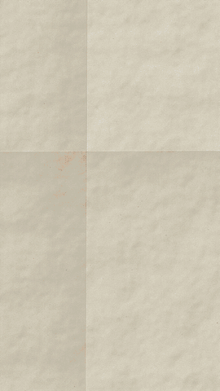
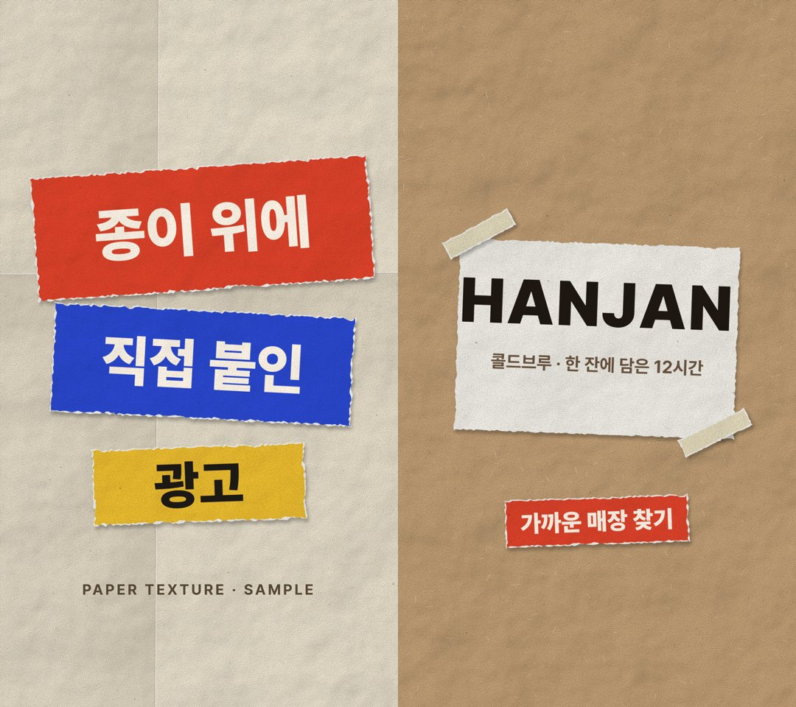
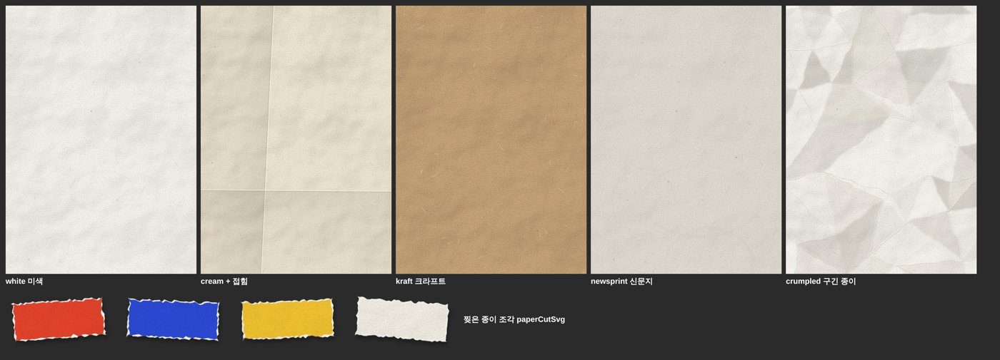

# 종이 질감 (paper texture)

`templates/paper.mjs`로 만든 종이 바탕·찢은 종이 조각·종이 결 오버레이 예제입니다. 엔진 3.0.28 브라우저 Exporter로 렌더했습니다.



| 구간 | 내용 |
|---|---|
| 0–3초 | 접힌 자국 2줄이 있는 크림 종이 바탕 + 찢은 색종이 조각이 박마다 탁 붙음(조각마다 `lineBoil` 8fps), 맨 위에 흰 바탕 종이 결 multiply |
| 3–5.5초 | 크라프트지 엔드카드, 테이프 조각 두 장, 빨간 CTA 조각 |



톤 프리셋 5종(white·cream+fold·kraft·newsprint·crumpled)과 찢은 조각:



```bash
node build.mjs            # → project.json
node <스킬>/templates/render/render.mjs project.json out/paper_9x16.mp4
```

영상·사진 소재 위에 구긴 종이 결을 multiply로 얹는 버전도 만들어 봤지만 사용자 검토에서 빠졌습니다(2026-11-18). 종이 질감은 그래픽 장면의 바탕과 조각에 씁니다.
