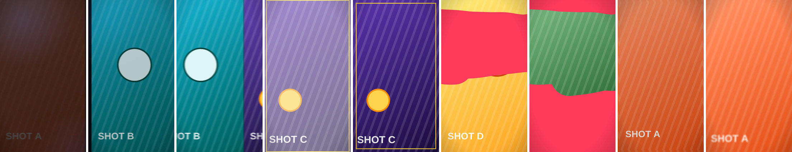

# 이음새 샘플: 소재 컷을 잇는 전환 6종 + 이음새 검사

1080×1920, 12.5초, 30fps. `@admaker/engine` 브랜치 빌드(엔진 PR kingsae1/admaker-plugin#37: am-zoom-blur, am-rack-focus 포함)의 브라우저 Exporter로 렌더했습니다. 바닥 소재는 자리표시 영상(`make-placeholder-footage.cjs`)입니다.




| 시간 | 전환 | 샷 카드 | 일어나는 일 |
|---|---|---|---|
| 2.0초 | 흐름 잇기 | `transition-cut-the-curve` | A가 왼쪽으로 가속하며 빠지고(12% 이동, 블러), B가 같은 방향에서 감속하며 들어옴 |
| 3.9초 | 휩 팬 | `transition-whip-pan` | 두 소재가 한 화면 너비를 왼쪽으로 함께 밀리며 모션 블러로 이어짐 |
| 5.6–6.4초 | 비트 정지 | `transition-beat-freeze` | 박에서 2프레임 흰 섬광, 정지 컷 + 노란 테두리, 6.4초에 다음 소재 |
| 8.0초 | 낙서 덮기 | `transition-scribble-cover` | 분홍 지그재그 획이 화면을 덮고, 지우개 획으로 다음 소재가 드러남 |
| 9.6초 | 줌 블러 | `transition-shader` (`am-zoom-blur`) | 앞으로 빨려 들어가듯 줌 + 블러, 셰이더 전환 |
| 11.0초 | 초점 넘기기 | `transition-shader` (`am-rack-focus`) | 초점이 풀렸다가 다음 소재에서 다시 맞음 |

`SEAMS` 표는 `validate.mjs`가 읽어 나가는 방향과 이어받는 방향(축·부호·속도)을 검사합니다(`references/transitions.md` §4).

## 다시 만들기

프로젝트 폴더에 `templates/` 전체와 `references/fonts.json`을 복사하고 `timeline.mjs`의 "섹션:" 아래를 `timeline.sample.mjs` 내용으로 바꿉니다.

```sh
node make-placeholder-footage.cjs
for i in 0 1 2 3 4; do ffmpeg -y -loop 1 -i assets/f$i.png -t 4 -r 30 -c:v libx264 -pix_fmt yuv420p assets/f$i.mp4; done
cp assets/*.mp4 assets/f2.png render/
FOOTAGE_PREFIX=/ node build-project.mjs --out project.json
node validate.mjs project.json
node render/render.mjs project.json out/seams.mp4
```

알려진 점: 비디오 디코딩 지연으로 컷 지점에서 이전 소재가 1프레임 남거나 다음 소재 시작이 잠깐 비는 경우가 있습니다(8.0초, 2.0초 근처).
