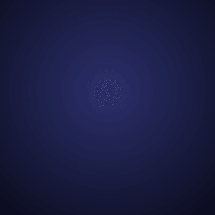
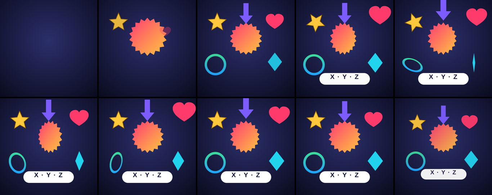

# 도형 시트 + X·Y·Z 회전 샘플

1080×1080, 6초, 30fps. 도형 7개(버스트 배지, 별, 하트, 링, 다이아몬드, 화살표, 알약)를 **시트 PNG 한 장**에 그려 두고, 클립마다 같은 이미지를 `crop`으로 칸만 다르게 보여 줍니다. 움직임은 X·Y·Z 회전과 깊이(`rotateX`, `rotateY`, `angle`, `z`)로만 만들었습니다. 렌더에는 `@admaker/engine` main(3.0.9 다음, `transform3d` 포함)을 썼습니다.

| 도형 | 축 | 움직임 |
|---|---|---|
| 버스트 배지 | Y + Z | 깊은 곳(z −1400)에서 카드처럼 뒤집히며(rotateY 85→0) 날아와 좌우로 흔들림(±45°) |
| 별 | X + Z회전 | 앞으로 넘어지며(rotateX −88→0) 등장, 그 뒤 `angle` 0→360 한 바퀴 |
| 하트 | Z(깊이) | z −900에서 다가온 뒤 z +220 박동 두 번 |
| 링 | X + Y | 두 축을 같이 기울여 궤도처럼 돎 |
| 다이아몬드 | Y | −80↔80 왕복 (옆면이 얇아지는 회전) |
| 화살표 | X + Z | 위에서 접혀 내려오며(rotateX 85→0) 펼쳐지고 z로 들락 |
| 알약 + "X · Y · Z" | X | 바닥에 누워 있다가(rotateX 80) 일어섬. 글자 Text도 같은 keyframes |
| 끝(5–6초) | 전부 | z −1600으로 멀어지며 사라짐 |

- 이미지 업로드·소스는 시트 1장입니다(`shapes/_sheet-1.png`, 1212×1820). 칸 좌표는 `shapes/shapes.json`의 `crop`을 그대로 클립 `crop`에 넣습니다.
- 3D 값은 클립 `transform3d`(고정 자세, 여기선 `perspective`만)에 keyframes 값이 더해집니다. 정지점마다 같은 키를 다 적고, 구간 이징은 앞 정지점의 `easing`으로 줍니다(`build.mjs`의 `at()`).
- 다시 만들기: `node <스킬>/templates/shape-pngs.mjs shapes.json shapes --sheet` → `node build.mjs` → `node render/render.mjs project.json out/stills --stills 0:6:0.5`. `project.json`은 시트를 data URL로 클립마다 넣어 커서(4MB) 저장소에 두지 않았습니다. 실제 광고에서는 시트를 파일·URL로 한 번만 두고 src로 가리킵니다.

## admaker 앱(MCP)에서 같은 것 만들기

앱에서 3D가 보이려면 엔진 다음 태그(3.0.10)와 앱 엔진 올리기, `make_shape_pngs`가 든 앱 릴리스가 필요합니다.

1. `make_shape_pngs { items: shapes.json의 items + 자리 x·y, scale: 2, addToTimeline: true }`
   → 시트 1장만 업로드되고, 도형마다 같은 미디어 클립이 crop으로 놓입니다. 결과의 `clips[].clipId`를 받습니다.
2. 클립마다 `update_clip { clipId, patch: { perspective: 1000, animations: [위 build.mjs의 keyframes] } }`
   (keyframes 값에 `rotateX`, `rotateY`, `z`, `angle`, `opacity`를 씀. 고정 기울기는 patch의 `rotateX`·`rotateY`·`z`)
3. 같은 도형을 더 놓으려면 `add_media_to_timeline { mediaId }` + `crop_clip { clipId, crop: cells[i].crop }` — 다시 올리지 않습니다.
