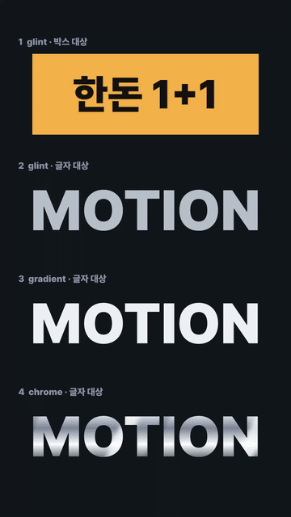
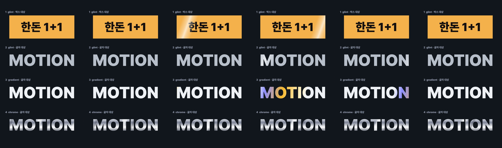

# 샤인 스윕 3종 (`sheenSweep`)

1080×1920, 4.5초. 빛띠·색띠·크롬 결을 트랙 매트(`style.matte`)로 대상 모양 안에서만 보이게 했습니다. 띠가 박스·글자보다 커도 밖으로 넘치지 않습니다. 샷 카드: `plugin/skills/admaker/references/shots/sheen-sweep.md`.

| # | kind | 대상 | 설명 |
|---|---|---|---|
| 1 | glint | 주황 박스 Shape | 박스를 매트로 써서 박스 안 글자("한돈 1+1")까지 함께 훑음. 0.4초·2.4초 두 번 |
| 2 | glint | Text "MOTION" | 글자 획 안에서만 흰 빛띠 |
| 3 | gradient | Text "MOTION" | 보라 → 주황 → 크림 띠가 흰 글자를 물들이며 지나감 |
| 4 | chrome | Text "MOTION" | 금속 결 + 사선 반사광이 글자 안에서 계속 흐름 |

- `node build.mjs` → `project.json` (앱 가져오기: `to-admaker-import.mjs`가 `transform.matte`로 옮김)
- `node build.mjs --fonts /fonts/` → 렌더 하니스용(폰트를 `render/fonts/`에서 읽음)
- 렌더: `@admaker/engine` 3.0.27 + composer 가시성 수정(admaker-plugin #54, 3.0.28에 포함). 수정 전 엔진은 매트 묶음이 켜지고 꺼지는 프레임마다 다른 클립이 사라지고 띠가 도려지지 않은 채 보였습니다(135프레임 중 26곳). 수정 후 0곳.
