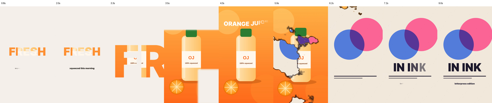

# 트랙 매트 · 잉크 번짐 · 글자 3D 샘플

1080×1920, 10초, 30fps. 갤러리 레퍼런스 text-as-mask, print-texture-transitions, assemble-then-type-flyin의 기법을 엔진 기능 그대로 쓴 예제입니다. `@admaker/engine` main(3.0.17, `style.matte`·`am-ink-bleed`·글자 3D 포함) 렌더 하니스로 렌더했습니다. 제품 사진·종이 장면은 SVG 자리표시입니다.




| 시간 | 장면 | 쓰는 것 |
|---|---|---|
| 0–3.6초 | 제품 사진이 "FRESH" 글자 안에서만 보임 → F 세로 획 속으로 60배 확대되며 화면을 채움 | 사진 클립 `style.matte { clipId: "title", mode: "alpha" }`, 제목 Text keyframes `scale` + `x`·`y` |
| 0.7–2.8초 | 부제 "squeezed this morning" | 글자 3D `flip_in_x` → `fade_out` |
| 3.6–6.6초 | 매트 없는 같은 사진으로 이어 붙임 | 매트 확대가 끝나는 시각에 컷 (매트 클립이 끝나면 alpha 대상은 숨음) |
| 3.8–5.3초 | "ORANGE JUICE" | `tumble_in` 입장 → `flip_out_x` 퇴장 |
| 5.4–6.6초 | 종이 장면으로 잉크가 번지며 넘어감 | 전환 `am-ink-bleed` (`values`: origin·edgeColor·seed) |
| 6.7–10초 | "IN INK" + "letterpress edition" | `flip_in_y`, `flip_in_x` |

## 값이 들어가는 곳

- **트랙 매트**는 도려낼 클립(대상)에 겁니다: `style.matte { clipId, mode, hideSource, feather, threshold, softness }`. 매트 클립(제목)은 기본으로 숨겨집니다. 표는 `engine-recipes.md` §2.4.1.
- **글자 안으로 확대**: scale은 박스 가운데를 기준으로 커지므로, 글자 획 안의 점 P를 제자리에 두려고 정지점마다 `x = −(P.x − 가운데.x) × (scale − 1)`, `y`도 같은 식으로 줍니다(`build.mjs`의 `zoomAt`). 같은 정지점·같은 이징이라 사이 값도 맞습니다. P는 글꼴·크기에 따라 다르니 바꾸면 스틸에서 획 안의 점을 다시 잽니다. 획 폭(여기선 약 40px) × 최종 배율이 화면 끝까지 덮을 만큼 배율을 크게 둡니다.
- **글자 3D**는 Text `style.characterAnimation`의 프리셋입니다(`tumble_in`, `flip_in_x`, `flip_in_y`, 퇴장 `flip_out_x`). 원근은 `charPerspective`(기본 800).
- **잉크 번짐**은 전환 클립 `transitionKey: "am-ink-bleed"`, `fromClipId`/`toClipId` 두 클립이 전환 구간만큼 겹쳐야 합니다.
- 글꼴은 Pretendard Black 하나(`fonts.mjs`의 `fontStyle`)입니다.

## 다시 만들기 (렌더 하니스)

`project.json`은 앱 가져오기용입니다. 렌더 하니스의 Text는 `characterAnimation`을 그리지 않아서, 렌더할 때는 글자 3D 클립을 앱과 같은 글자 렌더러(`scripts/text-segment.js`) 어댑터로 바꾼 파일을 만듭니다.

```sh
# 프로젝트 폴더: 이 폴더 파일 + 스킬 templates/render/ + @admaker/engine, vite, playwright
mkdir -p render/fonts && cp <Pretendard-Black.woff2> render/fonts/   # 네트워크가 되면 생략하고 --harness 만
node build.mjs --harness /fonts/            # → project.harness.json
node render/render.mjs project.harness.json out/track_matte_glyph3d.mp4
```

- 하니스의 겹침 순서는 **tracks 배열 앞쪽이 위**입니다. `build.mjs`는 뒤에 넣은 클립 트랙을 앞에 끼웁니다.
- `am-*` 전환은 `registerAdmakerTransitions()`를 불러야 그려집니다(`templates/render/main.js`에 넣어 둠).
- 스틸(`--stills`, Preview 경로)에서는 글자 어댑터가 함께 있을 때 잉크 번짐의 다음 장면이 검게 나옵니다. 영상 내보내기(Exporter)는 정상이라 스틸은 mp4에서 뽑았습니다.

## admaker 앱에서

- 가져오기: `node <스킬>/templates/to-admaker-import.mjs project.json wire.json` → 앱 "광고 불러오기" 또는 MCP `import_to_admaker`. 매트는 `transform.matte { clip: 매트 클립 이름 }`으로 옮겨지고(앱 #265 이후 저장 유지), 글자 3D는 텍스트 애니메이션 그대로 들어갑니다.
- `am-ink-bleed`는 앱 미리보기·브라우저 내보내기에서는 그대로 보이고, 서버 인코딩에서는 `dissolve`로 바뀝니다.
- 앱에서 직접 만들 때: 글자 3D는 텍스트 클립 → 속성 패널 텍스트 애니메이션(나타남: 가로로 뒤집기·세로로 뒤집기·굴러 들어오기, 사라짐: 뒤집혀 사라지기), 잉크 번짐은 미디어 패널 전환 탭 "잉크 번짐". 매트를 거는 Studio UI는 아직 없어서 매트는 가져오기·MCP로만 넣습니다.
