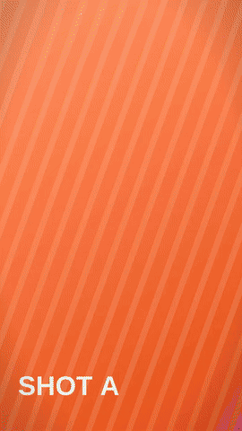
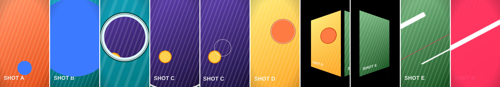

# 전환 샘플: 소재 컷을 잇는 전환 5종

1080×1920, 11초, 30fps. `@admaker/engine` 3.0.7 렌더 하니스(Preview 스틸, 브라우저 Exporter mp4)로 렌더했습니다. 바닥 소재는 직접 만든 자리표시 영상(`make-placeholder-footage.cjs`: 그라데이션 + 둥근 물체 + SHOT 라벨)입니다.





| 시간 | 전환 | 샷 카드 | 일어나는 일 |
|---|---|---|---|
| 1.7–2.3초 | 커버 | `transition-cover-flood` | 아래쪽 점이 원으로 부풀어 덮고, 다음 소재의 창(540, 820)으로 줄어듦 |
| 3.3–4.0초 | 공간 전환(줌) | `transition-zoom-through` | 창을 향해 4.6배 다가가며 창 안이 다음 소재로 열림, 흰 링 |
| 5.2–6.0초 | 매치 컷 | `transition-match-cut` | 왼쪽으로 밀리며 컷, 노란 원을 감싼 링이 다음 소재의 주황 원에 착지 |
| 7.0–8.0초 | 차원 이동 | `transition-footage-card` | 소재가 카드로 줄며 기울어 빠지고, 다음 소재 카드가 정면으로 펴짐 |
| 9.3–9.6초 | 플래시 | `transition-flash-streak` | 흰색·분홍 선 4가닥이 사선으로 지나가고 화면이 분홍으로 번쩍이며 컷 |

## 다시 만들기

프로젝트 폴더에 `templates/` 전체와 `references/fonts.json`을 복사하고 `timeline.mjs`의 "섹션:" 아래를 `timeline.sample.mjs` 내용으로 바꿉니다. `brand.json`은 `brand.example.json`을 씁니다.

```sh
node make-placeholder-footage.cjs                          # assets/f0–f4.png (Playwright)
for i in 0 1 2 3 4; do ffmpeg -y -loop 1 -i assets/f$i.png -t 4 -r 30 -c:v libx264 -pix_fmt yuv420p assets/f$i.mp4; done
cp assets/*.mp4 render/
FOOTAGE_PREFIX=/ node build-project.mjs --out project.json   # 렌더 하니스용 (render/ 안의 파일)
node validate.mjs project.json
node render/render.mjs project.json out/transitions_9x16.mp4
node render/sheet.mjs project.json out/sheets              # 전환 구간 밀집 시트 (Q18)
node build-project.mjs --out project.import.json && node to-admaker-import.mjs project.import.json admaker-import.json
```

## 렌더하며 고친 것

- 매치 컷 링이 다음 소재가 밀려 들어오는 0.2초 동안 물체와 어긋났습니다. 컷 순간 위치에 다음 소재의 밀림을 얹고 같은 이징으로 내려앉게 고쳤습니다.
- 카드 전환 뒤 배경을 Shape(z 1)로 깔았더니 화면이 배경색만 나왔습니다. 렌더 하니스는 뒤 트랙을 위에 그립니다. 배경은 `settings.backgroundColor`로 바꿨습니다.
- 플래시: 분홍 선이 초록 소재 위에서 묻혀 `blendMode: "add"`로, 번쩍임은 `screen`이 밝은 소재에서 거의 안 보여 기본을 `normal`로 바꿨습니다.
- 카드가 기울면 x 이동이 덜 보여서 빠지는 쪽 이동을 0.95W → 1.5W로 늘렸습니다.

## 앱으로 넘길 때

`to-admaker-import.mjs`가 keyframes(rotateY·motionBlur 포함)와 `circleReveal`을 그대로 넘깁니다(전환 0개, 모두 클립 모션). 앱 미리보기·서버 렌더에서 같은 모습인지는 아직 확인하지 않았습니다.
