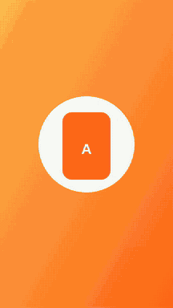
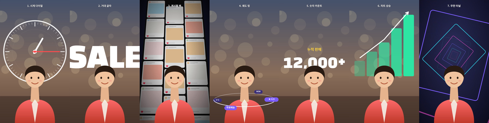
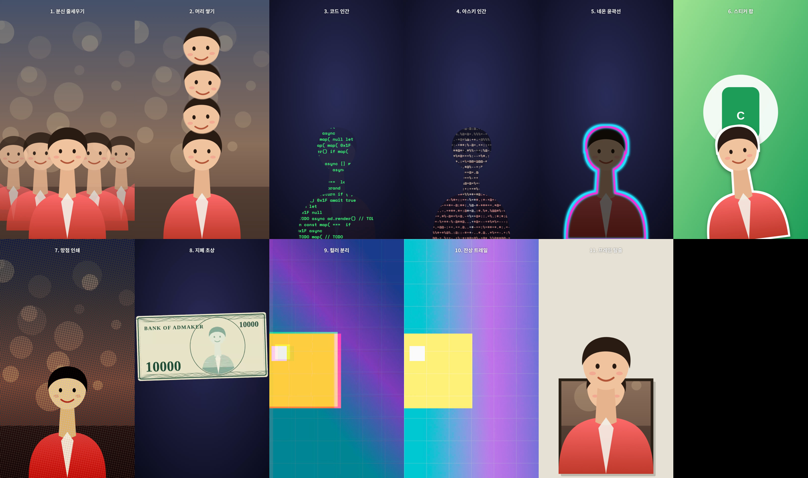
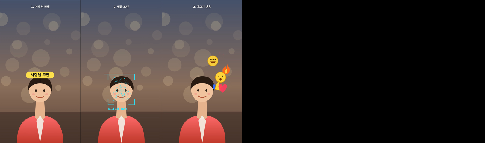
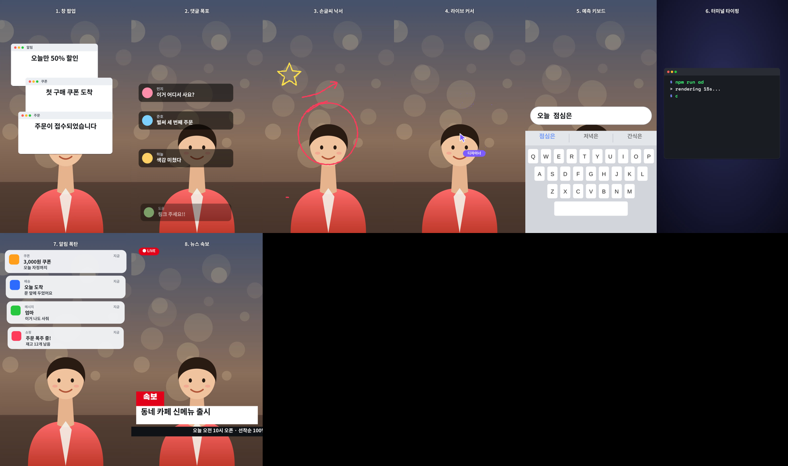
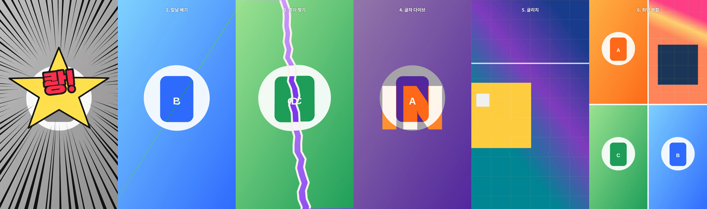
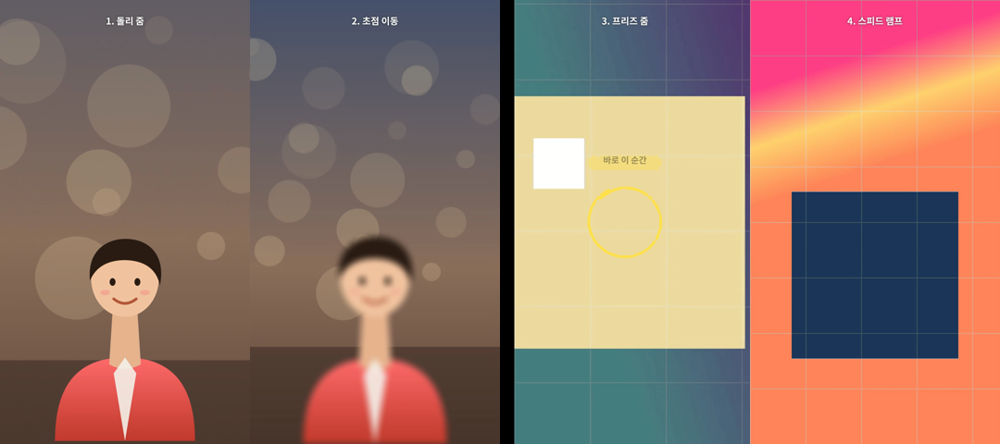

# 영상 이펙트 39종 샘플

1080×1920, 30fps. 카테고리마다 프로젝트 하나에 효과를 차례로 넣었습니다(위 가운데 번호 = `references/video-effects.md` 표 번호). 모두 `templates/effects.mjs` 함수 호출이고 엔진 기본 클립만 써서 앱 가져오기가 됩니다. `@admaker/engine` 3.0.20 렌더 하니스(브라우저 Exporter mp4)로 렌더해 프레임을 뽑았습니다.

인물·배경·제품은 SVG 자리표시입니다. 인물은 투명 배경 누끼 PNG 자리(실제로는 `ai.image.removeBackground`·`separateLayers` 결과), 영상은 `make-footage.sh`가 만든 그라데이션 + 움직이는 사각형입니다.

| 카테고리 | 길이 | 효과 | 미리보기 |
|---|---|---|---|
| 인물 뒤 공간 | 18.2초 (2.6초 × 7) | 시계 다이얼 · 거대 글자 · 게시물 벽 · 궤도 링 · 숫자 카운트 · 차트 상승 · 무한 터널 |  |
| 인물 변형 | 26.4초 (2.4초 × 11) | 분신 줄세우기 · 머리 쌓기 · 코드 인간 · 아스키 인간 · 네온 윤곽선 · 스티커 팝 · 망점 인쇄 · 지폐 초상 · 컬러 분리 · 잔상 트레일 · 프레임 탈출 |  |
| 얼굴 추적 | 9초 (3초 × 3) | 머리 위 라벨 · 얼굴 스캔 · 이모지 반응 (사진이 흔들리는 경로 = track) |  |
| 화면 오버레이 | 24초 (3초 × 8) | 창 팝업 · 댓글 폭포 · 손글씨 낙서 · 라이브 커서 · 예측 키보드 · 터미널 타이핑 · 알림 폭탄 · 뉴스 속보 |  |
| 전환·임팩트 | 18.6초 (3초 × 6) | 만화 임팩트 · 칼날 베기 · 종이 찢기 · 글자 다이브 · 글리치 · 화면 분할 |  |
| 카메라 | 13.2초 | 돌리 줌 · 초점 이동 · 프리즈 줌 · 스피드 램프 |  |

효과마다 가운데 시점 스틸: `stills/<카테고리>.png`.








## 값이 들어가는 곳

- 인물 누끼 박스 `SUBJECT_BOX`(190, 860, 700×1060), 머리 원 `HEAD`(540, 1200, r 150). 머리 쌓기·얼굴 추적·머리 위 라벨이 이 값을 씁니다. 실제 소재에서는 스틸에서 잽니다.
- 얼굴 추적은 바닥 사진에 준 흔들림 keyframes와 같은 값으로 `track`을 만들어 그래픽이 얼굴에 붙어 있습니다(`build.mjs` face).
- 글자 다이브 `point`(395, 1150)는 Black Han Sans 540px "IN"의 I 세로 획 안 점입니다.
- 프리즈 줌 정지 프레임은 `move.mp4` 2.0초(`make-footage.sh`가 `move_freeze.png`로 뽑음). 영상 클립이 원본 1초에서 시작해 타임라인 7초 = 원본 2초입니다.
- 스피드 램프: 원본 0.6초 1배 → 0.45초를 1→0.3배 3조각 → 1.5초를 0.3→2.5배 4조각.

## 다시 만들기 (렌더 하니스)

```sh
# 작업 폴더: 스킬 templates/render/ + @admaker/engine(install-engine.mjs --render)
sh make-footage.sh                       # render/move.mp4, move2.mp4, move_freeze.png
node build.mjs                           # out/<카테고리>.json 6개 (--only overlay 로 하나만)
node <스킬>/templates/validate.mjs out/overlay.json
node render/render.mjs out/overlay.json out/overlay.mp4
```

- 스틸은 mp4에서 뽑습니다(`ffmpeg -ss <초> -i out/overlay.mp4 -frames:v 1 f.png`). `render.mjs --stills`(Preview)는 클립 효과·트랙 매트가 있는 프레임에서 그 위 글자를 빼고 그립니다.
- 렌더는 GPU 없는 컨테이너에서 효과 많은 20초 프로젝트가 5–7분 걸렸습니다.

## admaker 앱에서

```sh
node <스킬>/templates/to-admaker-import.mjs out/overlay.json overlay.import.json   # → 앱 "광고 불러오기" 또는 MCP import_to_admaker
```

- 영상 src(`/move.mp4`)는 하니스용 경로라 앱에서는 업로드한 영상 URL로 바꿉니다(`FOOTAGE_PREFIX=<URL 앞부분> node build.mjs`).
- 클립 하나 = 트랙 하나로 만들어 행이 많습니다. 앱에 넣은 뒤 `arrange_tracks`로 정리합니다.
- 트랙 매트·클립 효과는 앱에 그대로 들어가고(미리보기·브라우저 내보내기), Studio에는 매트를 거는 UI가 아직 없습니다.
